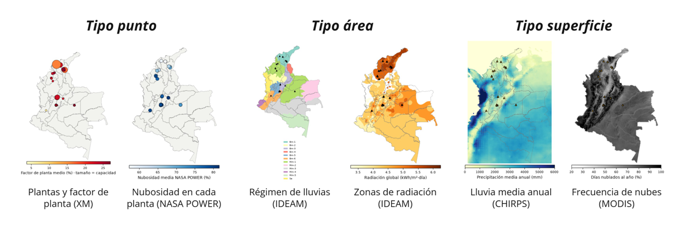
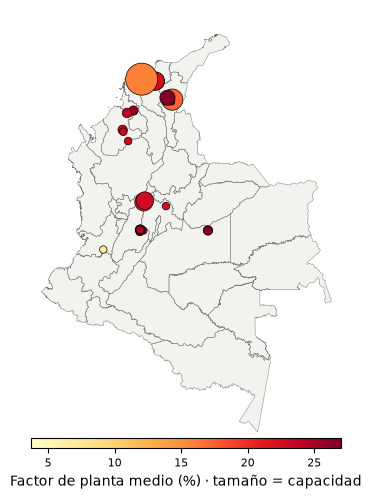
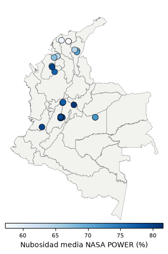
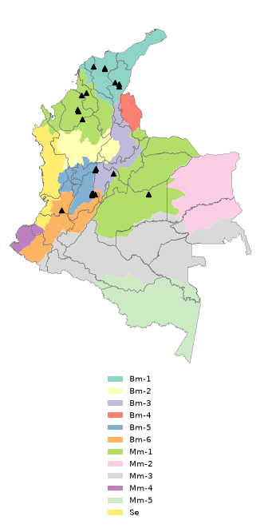
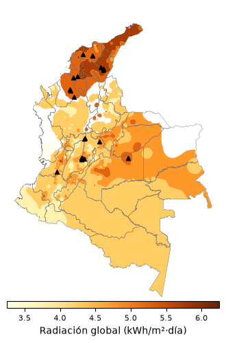
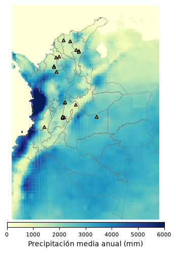
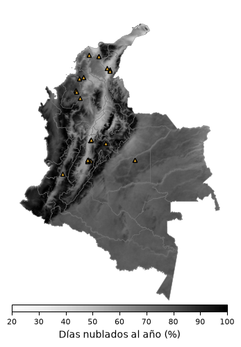

# Análisis geoespacial

**Nubosidad, precipitación y desempeño de las plantas solares fotovoltaicas de Colombia: un análisis geoespacial**

Proyecto del curso *Análisis Geoespacial* — Universidad Nacional de Colombia, Sede Medellín, Facultad de Minas, Departamento de Geociencias y Medio Ambiente.
Profesor: Edier Vicente Aristizabal Giraldo · Semestre 2026-02 · Autor: David Moreno Yepes

## Pregunta de investigación

¿Cuánto explican la nubosidad y la precipitación las diferencias espaciales y estacionales del factor de planta de las plantas solares fotovoltaicas de Colombia, y cambia esa relación entre regiones climáticas?

- **Periodo:** enero 2023 – diciembre 2024, paso mensual.
- **Unidad de análisis:** planta solar × mes.
- **Variable respuesta:** factor de planta = energía del mes ÷ (capacidad × horas del mes).

## Estructura del repositorio

```
Analisis-geoespacial/
├── datos/
│   ├── crudos/          # descargas originales (XM, OSM, CHIRPS, EarthEnv…)
│   └── procesados/      # capas y tablas listas para el análisis
└── desarrollo/
    ├── descarga_datos_v2.ipynb   # notebook que descarga todos los datos y genera los mapas
    ├── requirements.txt
    └── mapas/                    # mapas de la presentación (sección 7 del notebook)
```

> Los archivos de `datos/` se generan al ejecutar el notebook; ver `datos/README.md`.

## Datos

| Tipo | Dato | Fuente | Resolución |
|---|---|---|---|
| Punto | Generación real por planta → factor de planta mensual | XM (API Sinergox) | horaria → mensual |
| Punto | Despacho ideal, generación programada (despacho y redespacho), disponibilidad, irradiación y temperatura medidas en cada planta | XM (API Sinergox) | horaria / diaria → mensual |
| Punto | Ubicación de las plantas | Global Energy Monitor + OpenStreetMap | — |
| Punto | Nubosidad, radiación, índice de claridad, lluvia y temperatura en cada planta | NASA POWER | mensual, ~0,5° |
| Punto | Estaciones del IDEAM cercanas (≤ 30 km): precipitación, días de lluvia, temperatura y humedad observadas | IDEAM, Datos Abiertos (datos.gov.co) | 10 min → diaria → mensual |
| Punto | Normales climatológicas 1981–2010: lluvia, días de lluvia, temperatura, brillo solar, humedad, evaporación (≈340–2.000 estaciones) | IDEAM, «Promedios Climatológicos 1981–2010» | mensual (climatología) |
| Punto | Precipitación diaria CHIRPS en cada planta → días de lluvia y día más lluvioso | UCSB/CHC vía ERDDAP de NOAA | diaria, 0,05° |
| Área | Departamentos y municipios | geoBoundaries (DANE) | — |
| Área | Régimen pluviométrico 1981–2010 | IDEAM (OGC API Features) | — |
| Área | Zonas de radiación solar global promedio multianual | IDEAM (OGC API Features) | — |
| Superficie | Precipitación mensual CHIRPS v2.0 | UCSB/CHC vía ERDDAP de NOAA | 0,05° (~5 km) |
| Superficie | Frecuencia de nubes MODIS | EarthEnv (Wilson y Jetz, 2016) | ~1 km |
| Superficie | Elevación en cada planta | Copernicus GLO-30 | 30 m |

Todas las fuentes son públicas y no requieren cuenta. Ver `datos/README.md`.

## Cómo reproducir

1. `pip install -r desarrollo/requirements.txt`
2. Abrir `desarrollo/descarga_datos_v2.ipynb` (Jupyter o Google Colab) y ejecutar las celdas en orden.
3. Los datos quedan en `datos/` y los mapas en `resultados/mapas_presentacion/`.

## Mapas



| | | |
|---|---|---|
|  |  |  |
| Plantas y factor de planta (XM) | Nubosidad en cada planta (NASA POWER) | Régimen de lluvias (IDEAM) |
|  |  |  |
| Zonas de radiación (IDEAM) | Lluvia media anual (CHIRPS) | Frecuencia de nubes (MODIS) |

## Referencias principales

- Funk, C., et al. (2015). The climate hazards infrared precipitation with stations—a new environmental record for monitoring extremes. *Scientific Data*, 2, 150066.
- Wilson, A. M., y Jetz, W. (2016). Remotely sensed high-resolution global cloud dynamics for predicting ecosystem and biodiversity distributions. *PLoS Biology*, 14(3), e1002415.
- NASA Langley Research Center. Prediction Of Worldwide Energy Resources (POWER). https://power.larc.nasa.gov
- XM S.A. E.S.P. Sinergox. https://sinergox.xm.com.co
- IDEAM. Visualizador de información geográfica. https://visualizador.ideam.gov.co
