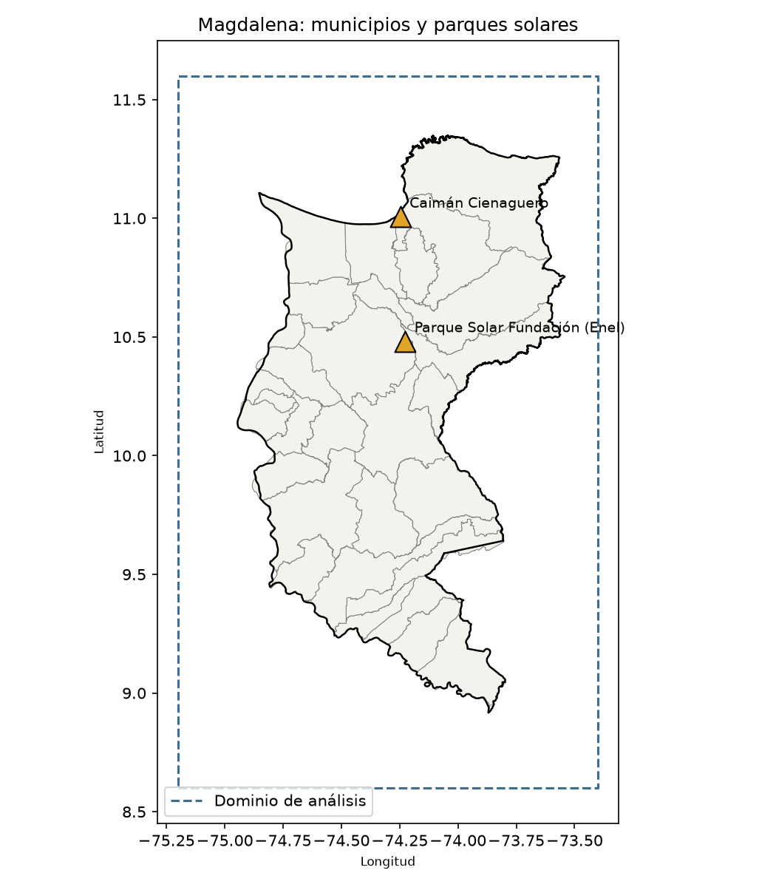
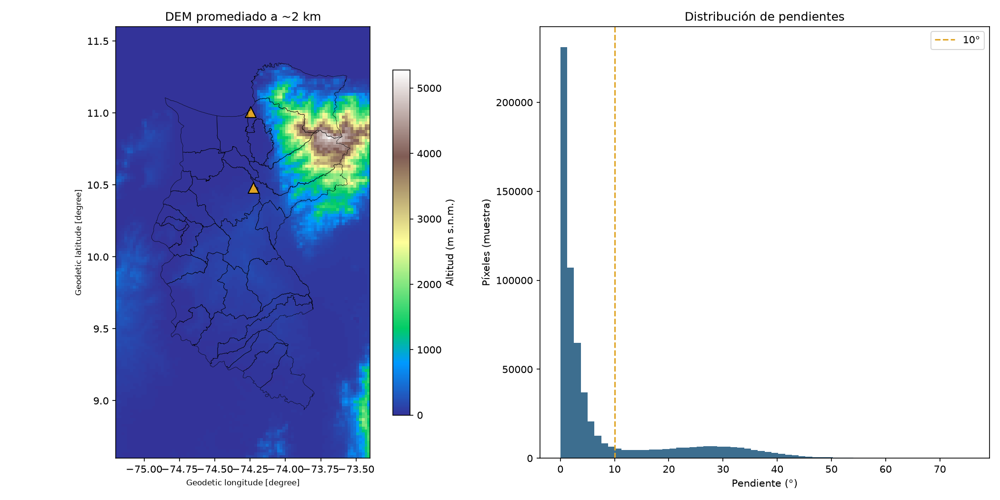
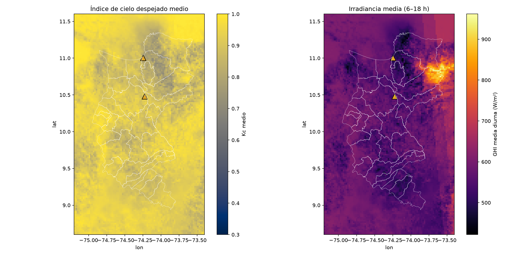
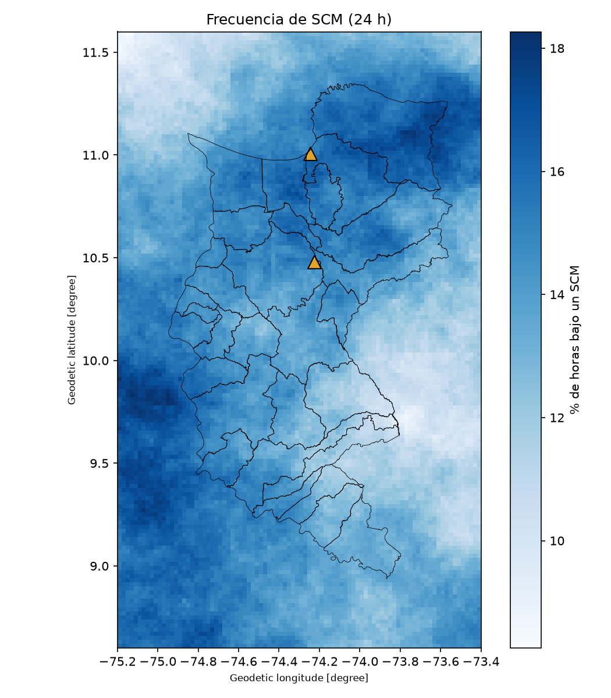
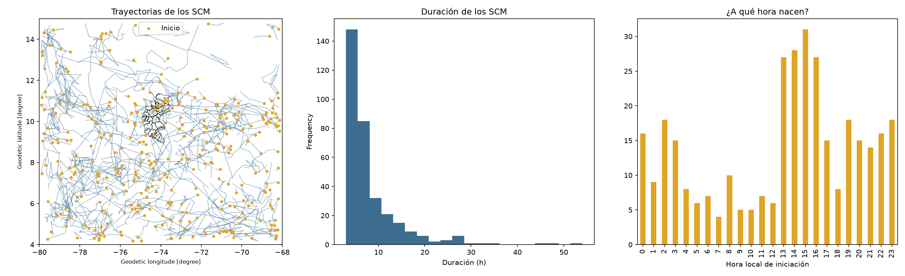

# Análisis geoespacial

**Sistemas convectivos de mesoescala (SCM) y generación solar fotovoltaica en el Magdalena**

Proyecto del curso *Análisis Geoespacial* — Universidad Nacional de Colombia, Sede Medellín, Facultad de Minas, Departamento de Geociencias y Medio Ambiente.
Profesor: Edier Vicente Aristizabal Giraldo · Semestre 2026-02 · Autor: David Moreno Yepes

## Pregunta de investigación

¿Cuánto reduce el paso de SCM la generación fotovoltaica en el Magdalena, y cómo varía esa reducción con la distancia al sistema, su etapa del ciclo de vida, la hora del día y el relieve?

Periodo de los datos: **octubre de 2024** (imágenes GOES cada 10 min) · Área: departamento del Magdalena.

## Estructura

```
├── datos/
│   ├── crudos/
│   │   ├── tb/                    # temperatura de brillo GOES canal 13 (10,3 µm), un NetCDF por día
│   │   ├── vis/                   # reflectancia visible GOES canal 2 (0,64 µm)
│   │   └── xm_listado_recursos.csv
│   └── procesados/
│       ├── region.gpkg, municipios.gpkg, parques.gpkg   # límites y parques solares
│       ├── dem_2km.tif                                   # DEM Copernicus remuestreado a 2 km
│       ├── irradiancia_202410.nc                         # irradiancia estimada desde satélite
│       ├── scm_mascara.nc, scm_poligonos.gpkg, scm_trayectorias.csv   # SCM identificados y seguidos
│       ├── fv_parques_horario.csv                        # generación FV estimada por parque
│       └── xm_recursos_solares.csv                       # plantas solares registradas en XM
├── desarrollo/
│   ├── notebooks/   # 00–08: descarga y procesamiento (Jupyter), con config.py y utils.py
│   ├── scripts/     # misma secuencia como scripts .py + guía del proyecto
│   └── mapas/       # mapas generados (área de estudio, DEM, irradiancia, frecuencia de SCM)
└── requirements.txt
```

## Flujo de trabajo

| Notebook | Qué hace | Tipo de dato |
|---|---|---|
| 00 | Instalación y configuración | — |
| 01 | Límites (geoBoundaries) y ubicación de parques | Área / punto |
| 02 | Modelo digital de elevación Copernicus GLO-30, pendiente y orientación | Superficie |
| 03 | Descarga de GOES-16/19 ABI (canales 2 y 13) desde AWS | Superficie |
| 04 | Irradiancia (GHI) estimada desde satélite | Superficie |
| 05 | Identificación y seguimiento de SCM (Tb ≤ 241 K) | Área |
| 06 | Generación FV estimada en los parques | Punto |
| 07 | Generación real de XM | Punto |
| 08 | Análisis espacial | — |

## Cómo ejecutar

```bash
pip install -r requirements.txt
```

`config.py` busca los datos en una carpeta `datos/` junto a los notebooks. Para reutilizar los datos de este repositorio sin descargarlos de nuevo, copia `datos/` dentro de `desarrollo/notebooks/` (o cambia `DATA` en `config.py`).

## Archivos no incluidos

GitHub no acepta archivos de más de 100 MB. Estos se generan de nuevo con el notebook 02:

| Archivo | Tamaño |
|---|---|
| `crudos/dem_mosaico.tif` | 463 MB |
| `procesados/dem_region_30m.tif` | 120 MB |
| `procesados/pendiente_grados.tif` | 135 MB |
| `procesados/orientacion_grados.tif` | 130 MB |

## Mapas

| | |
|---|---|
|  |  |
|  |  |



## Fuentes

GOES-16/19 ABI (NOAA, AWS Open Data) · Copernicus GLO-30 (ESA) · XM S.A. E.S.P. (Sinergox) · geoBoundaries · Global Energy Monitor.
